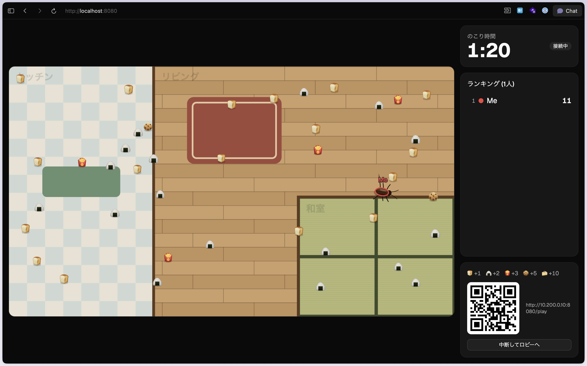

# Cockroach Game



## 開発

```sh
mise install
mise run dev
```

| コマンド          | 内容                                     |
| ----------------- | ---------------------------------------- |
| `mise run dev`    | webui ビルド -> サーバ起動               |
| `mise run build`  | 単一バイナリ `bin/cockroach-game` を作る |
| `mise run test`   | Go のテスト                              |
| `mise run ui:dev` | Vite dev server (HMR)                    |

## ディレクトリ構成

```text
cmd/server/        エントリポイント (フラグ、LAN IP の判定)
internal/game/     ゲームルールと状態管理
internal/server/   HTTP, WebSocket
internal/webui/    React + shadcn/ui (Vite)。dist/ を go:embed して配信
  embed.go           webui.FS()
  src/screen/        PC 画面 (canvas 描画)
  src/controller/    スマホのコントローラー
```
